# SRE-проект:

**WordPress на отказоустойчивом PostgreSQL (Patroni + Consul) с полным циклом метрик, логов и алертов.**

Проектная работа курса по SRE / Observability. Инфраструктура продукта принята у команды разработки и приведена к production-состоянию: база данных переживает отказ узла без участия человека, приложение само переключается на нового лидера, а каждый компонент виден в метриках, логах и алертах.

| | |
|---|---|
| **Где развёрнуто** | домашний Proxmox VE → ВМ `sre-host` (Ubuntu 22.04, 4 vCPU, 8 ГБ RAM, 40 ГБ) |
| **Как развёрнуто** | Ansible с MacBook: одна команда создаёт ВМ и поднимает весь стенд |
| **Как работает** | 25 контейнеров в Docker Compose на одной ВМ |
| **Наблюдаемость** | Prometheus · Loki · Grafana Alloy · Alertmanager · Grafana · Blackbox |

---

## Содержание

1. [Архитектура](#архитектура)
2. [Состав стенда](#состав-стенда)
3. [Развёртывание](#развёртывание)
4. [Наблюдаемость](#наблюдаемость)
5. [Как тестировалось](#как-тестировалось)
6. [Выводы](#выводы)
7. [Скриншоты](#скриншоты)
8. [Эксплуатация и диагностика](#эксплуатация-и-диагностика)
9. [Ограничения и развитие](#ограничения-и-развитие)
10. [Структура репозитория](#структура-репозитория)

---

## Архитектура

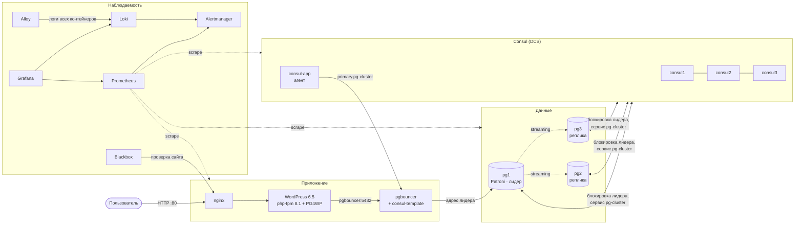

### Как устроено переключение при отказе БД

1. **Patroni** держит в Consul блокировку лидера с TTL 30 секунд и регистрирует сервис `pg-cluster` с тегом роли (`primary` или `replica`).
2. Лидер упал → блокировку никто не продлевает → через TTL самая свежая реплика берёт её и становится primary. Реплика, отставшая больше чем на 1 МБ WAL, лидером не станет (`maximum_lag_on_failover`).
3. **consul-template** видит новый экземпляр с тегом `primary`, перегенерирует секцию `[databases]` в pgbouncer и шлёт ему `SIGHUP`.
4. **WordPress** подключён к pgbouncer и адреса базы не знает: для него failover — короткая пауза.
5. Старый лидер после возвращения догоняет новый timeline через `pg_rewind` и становится репликой.

**Защита от split-brain:** если лидер теряет связь с кворумом Consul, Patroni сам переводит его в read-only.

---

## Состав стенда

### Платформа

| Компонент | Версия | Контейнер | Назначение |
|---|---|---|---|
| Proxmox VE | 8.x | — | гипервизор, на нём ВМ `sre-host` |
| Ubuntu | 22.04 LTS | — | ОС ВМ (облачный образ + cloud-init) и база образов Patroni/pgbouncer |
| Docker Engine + Compose | из download.docker.com | — | среда выполнения |
| Ansible | ≥ 2.15 (на Маке) | — | создание ВМ и развёртывание |

### Данные и приложение

| Компонент | Версия | Контейнер | Назначение |
|---|---|---|---|
| PostgreSQL | 15 (PGDG) | `pg1`, `pg2`, `pg3` | база данных, 1 лидер + 2 потоковые реплики |
| Patroni | из PGDG | внутри `pg*` | выбор лидера, failover, pg_rewind |
| Consul | 1.21 | `consul1–3`, `consul-app` | DCS: Raft-кворум 2 из 3, сервис-каталог |
| pgbouncer | 1.16 | `pgbouncer` | пул соединений, `pool_mode = session` |
| consul-template | 0.40 | внутри `pgbouncer` | адрес лидера → конфиг pgbouncer |
| WordPress + PG4WP | 6.5.5 / v3 | `wordpress` | сайт; PG4WP — слой совместимости с PostgreSQL |
| nginx | 1.27 | `nginx` | веб-сервер, JSON access-лог, rate limit на wp-login |

### Наблюдаемость

| Компонент | Версия | Контейнер | Что даёт |
|---|---|---|---|
| Prometheus | 3.5 | `prometheus` | сбор метрик, правила алертов, SLO |
| Alertmanager | 0.28 | `alertmanager` | группировка, подавление каскадов, рассылка в Telegram, почту и webhook |
| webhook-logger | Python | `webhook-logger` | приёмник webhook-уведомлений: пишет их в лог → Loki |
| Loki | 3.5 | `loki` | хранение логов, алерты по логам (ruler) |
| Grafana Alloy | 1.10 | `alloy` | сбор логов всех контейнеров через Docker API |
| Grafana | 12.0 | `grafana` | 6 дашбордов, Explore |
| Blackbox exporter | 0.26 | `blackbox` | проверка сайта «глазами пользователя» |
| node_exporter | 1.9 | `node-exporter` | метрики ВМ |
| postgres_exporter | 0.17 | `pgexp1–3` | метрики каждого узла PostgreSQL |
| pgbouncer_exporter | 0.10 | `pgbouncer-exporter` | пулы, ожидание, запросы |
| nginx-prometheus-exporter | 1.4 | `nginx-exporter` | RPS, соединения |
| php-fpm_exporter | 2.2 | `phpfpm-exporter` | воркеры, очередь, max_children |
| cAdvisor | 0.49 | `cadvisor` | CPU, память, сеть и диск каждого контейнера |
| Patroni REST API, Consul agent | — | — | встроенные метрики `/metrics`, `/v1/agent/metrics` |

### Порты на ВМ

| Порт | Что |
|---|---|
| 80 | сайт WordPress |
| 3000 | Grafana |
| 9090 | Prometheus |
| 9093 | Alertmanager |
| 8500 | Consul UI |
| 12345 | Alloy UI |

Остальные сервисы доступны только внутри docker-сети `172.28.0.0/16`.

---

## Развёртывание

Всё выполняется с управляющей машины (MacBook) из каталога `ansible/`.

### 1. Подготовка

| Что | Команда / действие |
|---|---|
| Ansible на Маке | `pip install ansible-core` |
| SSH-ключ в агенте (ключ с passphrase) | `ssh-add --apple-use-keychain ~/.ssh/id_ed25519` |
| Ключ на Proxmox | `ssh-copy-id root@<IP-proxmox>` |
| Имя хранилища Proxmox | `ssh root@<IP-proxmox> pvesm status` → обычно `local-lvm` |

В `ansible/inventory.yml` указать: IP Proxmox, **свободный** IP для ВМ, шлюз, хранилище, ресурсы ВМ. Каналы уведомлений — в `ansible/group_vars/docker_hosts/` (см. «Доставка уведомлений»).

### 2. Запуск

```bash
cd ansible
ansible pve -m ping          # проверка доступа к Proxmox
ansible-playbook site.yml    # ~20–30 минут
```

### 3. Что делает `site.yml`

**`provision-pve.yml` — ВМ на Proxmox** (через SSH и `qm`):

1. Скачивает облачный образ Ubuntu 22.04.
2. Создаёт из него шаблон `9000`.
3. Клонирует ВМ `201`. Через cloud-init задаёт пользователя, SSH-ключ, статический IP и DNS.
4. Расширяет диск, запускает ВМ, ждёт SSH.

**`deploy.yml` — стек на ВМ:**

1. Генерирует пароли на Маке в `ansible/credentials/` (один раз, дальше переиспользует).
2. Ставит Docker из официального репозитория, настраивает ротацию логов.
3. Копирует стек в `/opt/sre-stack`, пишет `.env` с паролями.
4. `docker compose pull` → `build` (образы Patroni, pgbouncer, WordPress) → `up -d`.
5. Ждёт лидера Patroni и готовности Prometheus, Alertmanager и Grafana, печатает адреса.

Повторный запуск безопасен: существующие шаблон, ВМ и пароли не пересоздаются.

### 4. Первый вход

| Что | Где |
|---|---|
| Сайт | `http://<IP-ВМ>/` → мастер установки WordPress |
| Grafana | `http://<IP-ВМ>:3000`, логин `admin`, пароль в `ansible/credentials/grafana_admin` |
| Командная строка | `ssh alexander@<IP-ВМ>`, затем `cd /opt/sre-stack && alias dc='sudo docker compose'` |

---

## Наблюдаемость

### Метрики

Prometheus опрашивает **22 цели** каждые 15 секунд. Метка `instance` у каждой цели — имя сервиса (`pg1`, `pgbouncer`…), а не IP: так алерты читаются по-человечески.

### Логи

Alloy читает stdout/stderr всех контейнеров через Docker API и ставит метки `service`, `container`, `stream`. Логи PostgreSQL и Patroni дополнительно обрабатываются: многострочные записи склеиваются, уровень (`LOG`/`ERROR`/`FATAL`…) выносится в метку `level`. nginx пишет access-лог в JSON, поэтому доля 5xx, перцентили времени ответа и топ URI считаются прямо по логам.

### Дашборды (папка SRE в Grafana)

| Дашборд | Что внутри |
|---|---|
| **Platform Overview** | SLI сайта и бюджет ошибок → приложение → pgbouncer → Patroni → Consul → хост → ошибки в логах. Смотрится сверху вниз до первого красного |
| **Логи** | поток логов и ошибок по сервисам, счётчики ошибок; nginx (коды, p50/p95/p99, топ URI и IP, медленные URI); PostgreSQL (уровни, медленные запросы, события Patroni); PHP и pgbouncer; ленты логов с фильтрами |
| **PostgreSQL и Patroni** | роли, timeline, связь с DCS, отставание реплик; транзакции, строки, cache hit; соединения, блокировки, дедлоки; размер БД, чекпойнты, топ запросов |
| **Веб** | фазы ответа blackbox; nginx; php-fpm (воркеры, очередь, slow); pgbouncer (клиенты, серверные соединения, ожидание, время запроса) |
| **Consul** | здоровье кворума, запас отказоустойчивости, Raft (lastContact, commit), RPC, KV |
| **Хост и контейнеры** | CPU, память, диск, сеть ВМ; CPU, память и сеть по контейнерам; таблица всех целей Prometheus |

На всех дашбордах есть аннотация «Failover / switchover» (рост timeline) и выпадающий список для перехода между ними.

### Алерты: 33 правила в Prometheus + 4 по логам в Loki

| Группа | Алерты |
|---|---|
| Сайт и SLO | `SiteDown`, `SiteSlow`, `SLOErrorBudgetBurnFast`, `NginxDown`, `PhpFpmMaxChildrenReached`, `PhpFpmListenQueue` |
| Patroni | `PatroniNoLeader`, `PatroniSplitBrain`, `PatroniFailoverHappened`, `PatroniPostgresNotRunning`, `PatroniReplicaCountLow`, `PatroniReplicationLagHigh` |
| PostgreSQL | `PostgresDown`, `PostgresTooManyConnections`, `PostgresDeadlocks` |
| pgbouncer | `PgbouncerDown`, `PgbouncerClientsWaiting`, `PgbouncerMaxWaitHigh` |
| Consul | `ConsulNoLeader`, `ConsulClusterUnhealthy`, `ConsulNoFailureTolerance` |
| Хост | `InstanceDown`, `TargetDown`, `HostHighCpu`, `HostLowMemory`, `HostDiskSpaceLow`, `HostDiskSpaceCritical`, `HostDiskWillFillIn24h`, `HostClockNotSynced` |
| Мониторинг мониторинга | `Watchdog`, `PrometheusRuleEvaluationFailures`, `PrometheusNotificationsFailing`, `AlertmanagerNotificationsFailing` |
| По логам (Loki) | `Nginx5xxRateHigh`, `PostgresFatalErrors`, `PhpFatalErrors`, `PgbouncerServerLoginFailed` |

**Принципы:**
- **Два уровня важности.** `critical` — пользователь не может работать или вот-вот не сможет. `warning` — деградация, которую нужно разобрать в рабочее время.
- **Без шторма.** Упавший узел (`InstanceDown`) глушит остальные алерты по нему; `critical` глушит `warning` того же алерта.
- **`Watchdog` горит всегда.** Если он пропал — сломана сама цепочка Prometheus → Alertmanager.
- **У каждого алерта есть подсказка:** в описании указана команда или запрос, с которых начинать разбор.

### Доставка уведомлений

| Канал | Что получает | Настройка |
|---|---|---|
| **Telegram** | `critical` и `warning`: 🔥 при срабатывании, ✅ при решении | `vault_telegram_bot_token`, `vault_telegram_chat_id`; при закрытом доступе к api.telegram.org — `vault_telegram_proxy_url` |
| **Почта** | только `critical` (письмо с таблицей алертов) | `alert_email_to`, `alert_smtp_*`, `vault_smtp_password` |
| **Webhook** | `critical` и `warning` в JSON | `alert_webhook_url`; по умолчанию встроенный `webhook-logger` |

- Канал включается, только если для него заданы переменные. Без них Alertmanager всё равно доставляет уведомления в webhook.
- Конфиг `alertmanager.yml` собирается Ansible из шаблона `ansible/templates/alertmanager.yml.j2`, тексты сообщений — `config/alertmanager/templates/notify.tmpl`. После сборки плейбук проверяет конфиг через `amtool check-config`.
- `webhook-logger` пишет каждое уведомление JSON-строкой в лог, так что история алертов видна в Loki: дашборд «Логи», раздел «Уведомления Alertmanager».
- `Watchdog` никуда не рассылается. Сбой доставки в любой канал сам вызывает алерт `AlertmanagerNotificationsFailing`.

Настройка каналов:

```bash
cd ansible/group_vars/docker_hosts
vim alerting.yml                                  # почта: адрес, SMTP-сервер, логин
cp vault.yml.example vault.yml && vim vault.yml   # токен бота, chat_id, пароль SMTP
ansible-vault encrypt vault.yml
cd ../.. && ansible-playbook deploy.yml --ask-vault-pass
```

`vault.yml` добавлен в `.gitignore`: репозиторий публичный, а в файле личный токен бота и пароль почты. В git лежит только шаблон `vault.yml.example`.

Тест доставки без учений:

```bash
dc exec alertmanager amtool alert add TestAlert severity=critical instance=test \
  --annotation='summary="Проверка доставки"' --alertmanager.url=http://localhost:9093
```

### SLO

- **SLI:** доля успешных проверок blackbox главной страницы. Успешной считается проверка с HTTP 200, в теле которой есть разметка WordPress: ошибку БД WordPress может отдать и с кодом 200.
- **SLO:** 99,5% за 30 дней. Это бюджет около 3,6 часа простоя в месяц.
- **Алерт по скорости сжигания бюджета** (burn rate ×14,4, окна 1 ч и 5 мин): будит человека за час деградации, а не за пару плохих минут.

---

## Как тестировалось

### Статические проверки (до развёртывания)

| Проверка | Инструмент |
|---|---|
| Синтаксис плейбуков | `ansible-playbook --syntax-check site.yml` |
| Валидность compose-файла | `docker compose config -q` |
| Все PromQL-выражения в правилах и дашбордах (≈ 160) | парсер PromQL (`promql-parser`) |
| YAML всех конфигов | `yaml.safe_load` |
| Шаблоны consul-template и cloud-init | ручной рендер и просмотр результата |

### Проверка после развёртывания

| # | Что проверяем | Команда | Ожидаем |
|---|---|---|---|
| 1 | Контейнеры | `dc ps` | все `Up` |
| 2 | Кворум Consul | `dc exec consul1 consul operator raft list-peers` | 1 leader + 2 follower |
| 3 | Кластер Patroni | `dc exec pg1 patronictl -c /etc/patroni.yml list` | 1 Leader + 2 Replica `streaming`, Lag 0 |
| 4 | pgbouncer смотрит на лидера | `dc exec pgbouncer cat /etc/pgbouncer/databases.ini` | `host=` = лидер |
| 5 | Цели Prometheus | `http://<IP>:9090/targets` | все UP |
| 6 | Алерты | `http://<IP>:9090/alerts` | горит только `Watchdog` |
| 7 | Логи | Grafana → Explore → `{service="nginx"} \| json` | строки с полями |

### Учения

Фоновая проверка во время учений — запрос к сайту раз в секунду:

```bash
while true; do curl -s -o /dev/null -w "%{http_code} %{time_total}\n" http://localhost/; sleep 1; done
```

| # | Сценарий | Как воспроизвести | Что должно произойти |
|---|---|---|---|
| 1 | Плановое переключение лидера | `dc exec pg1 patronictl -c /etc/patroni.yml switchover --force` | новый лидер, TL +1, pgbouncer переключён, алерт `PatroniFailoverHappened` |
| 2 | Падение лидера | `dc stop <лидер>` | через ~30–40 с новый лидер; `PostgresDown`, `PatroniReplicaCountLow`; после `dc start` узел вернулся репликой |
| 3 | Зависание лидера | `dc pause <лидер>`, через 60 с `dc unpause` | то же, что при падении, но процесс жив — защита через TTL блокировки |
| 4 | Потеря сервера Consul | `dc stop consul3` | кворум 2/3 держится, алерт `ConsulNoFailureTolerance` |
| 5 | Отказ пулера | `dc stop pgbouncer` | `PgbouncerDown`, `SiteDown` в течение ~1 мин |
| 6 | Нагрузка | `ab -n 3000 -c 30 http://localhost/` | рост RPS и p95, видно узкое место |

---

## Выводы

- **Отказоустойчивость:** отказ узла БД закрывается автоматически, без участия человека.
- **Наблюдаемость:** каждый отказ на учениях был виден в метриках, логах и алертах, а алерты указывали на причину, а не только на симптом.
- **Внешняя проверка нужна:** blackbox проверяет содержимое страницы, а не только код ответа.
- **Кардинальность:** поля с уникальными значениями (`request_id`, `time`) нельзя превращать в метки. Запрос перцентилей сначала упёрся в лимит Loki в 500 рядов; исправлено тем, что из лога извлекаются только нужные поля.
- **Сопоставление меток в PromQL:** деление вектора с метками на вектор без меток молча даёт пустой результат. Исправлено через `scalar()`.

---

## Скриншоты

Все скриншоты лежат в [`docs/screenshots/`](docs/screenshots/).

| # | Файл | Что на скриншоте |
|---|---|---|
| 01 | `01-proxmox-vm.png` | ВМ `sre-host` в Proxmox (Summary: CPU, RAM, IP) |
| 02 | `02-ansible-recap.png` | вывод `ansible-playbook site.yml`: блок «Итог» |
| 03 | `03-docker-ps.png` | `dc ps` — все сервисы, состояние во время тестирования |
| 04 | `04-consul-services.png` | `consul services` |
| 05 | `05-consul-ui.png` | Consul UI → Services → `pg-cluster` с тегами primary/replica |
| 06 | `06-prometheus-targets.png` | Prometheus → Targets |
| 07 | `07-prometheus-alerts.png` | Prometheus → Alerts |
| 08 | `08-dash-overview.png` | дашборд Platform Overview |
| 09 | `09-dash-logs.png` | дашборд «Логи» |
| 10 | `10-dash-postgres.png` | дашборд PostgreSQL и Patroni |
| 11 | `11-dash-web.png` | дашборд «Веб» |
| 12 | `12-dash-consul.png` | дашборд Consul |
| 13 | `13-dash-host.png` | дашборд «Хост и контейнеры» |
| 14 | `14-loki-explore.png` | Explore: разобранная JSON-строка nginx |
| 15 | `15-telegram.png` | уведомления в Telegram: 🔥 при срабатывании и ✅ при решении |
| 16 | `16-webhook-loki.png` | дашборд «Логи» → «Уведомления Alertmanager» |

### Галерея

#### Развёртывание и платформа

| | |
|---|---|
| 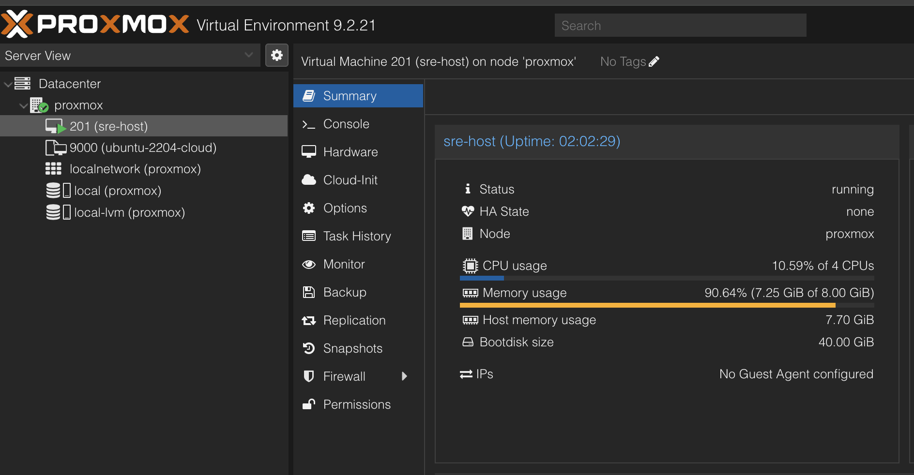<br>**01.** ВМ `sre-host` в Proxmox | 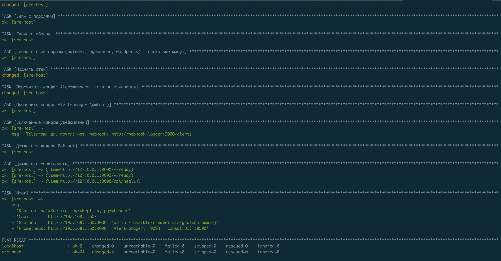<br>**02.** Итог `ansible-playbook site.yml` |
| 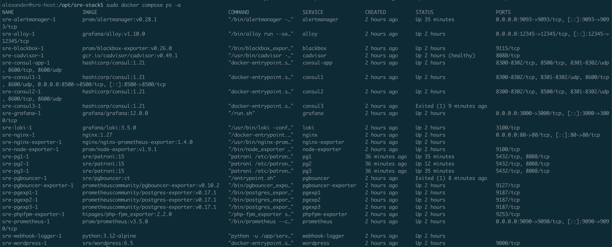<br>**03.** Сервисы стенда (`dc ps`) | 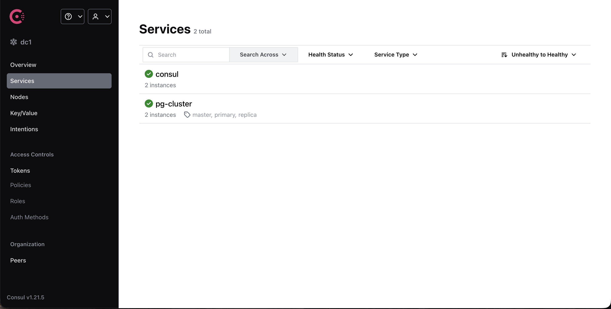<br>**04.** Сервисы в Consul |
| 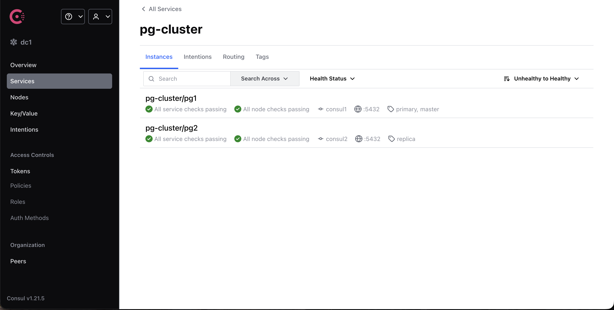<br>**05.** `pg-cluster`: теги primary/replica | |

#### Сбор метрик и алертинг

| | |
|---|---|
| 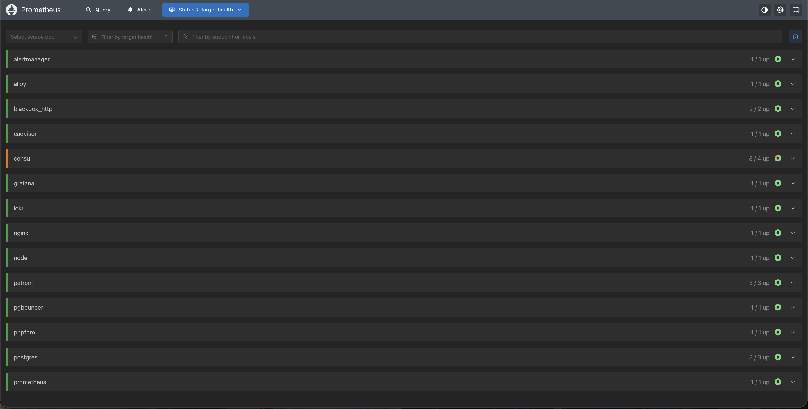<br>**06.** Prometheus → Targets: все UP | 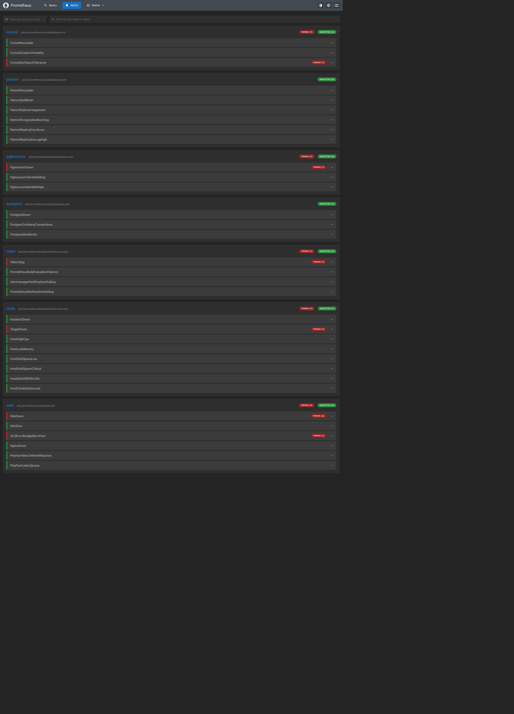<br>**07.** Prometheus → Alerts |

#### Дашборды Grafana

| | |
|---|---|
| <br>**08.** Platform Overview | <br>**09.** Логи |
| 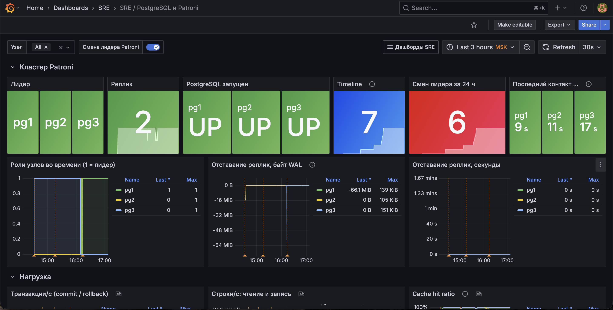<br>**10.** PostgreSQL и Patroni | 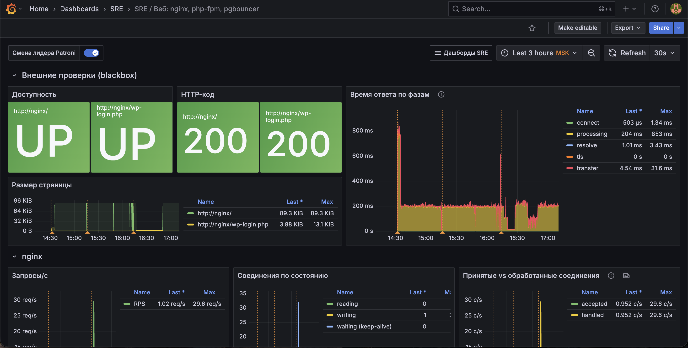<br>**11.** Веб |
| 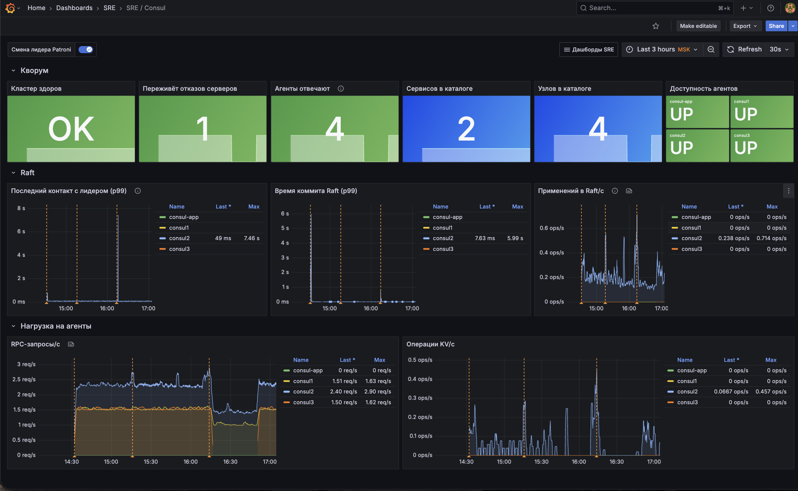<br>**12.** Consul | 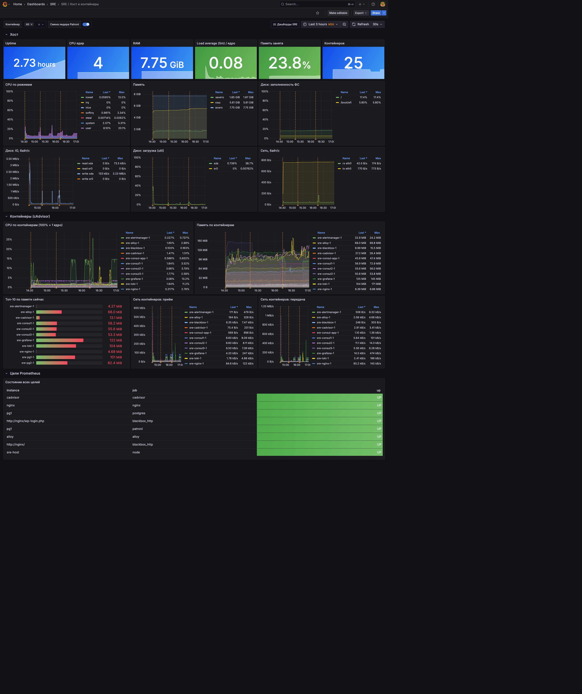<br>**13.** Хост и контейнеры |

#### Логи и уведомления

| | |
|---|---|
| 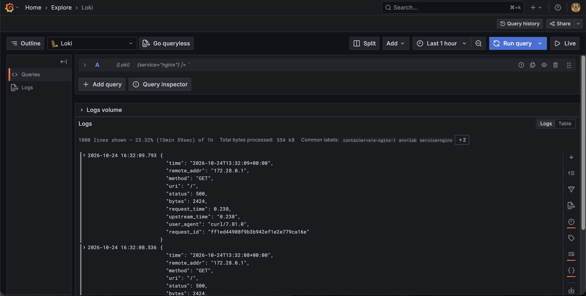<br>**14.** Explore: JSON-лог nginx, разобранный по полям | 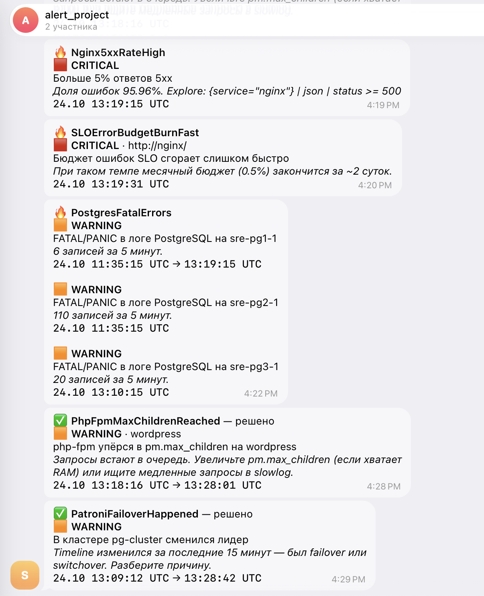<br>**15.** Telegram: 🔥 срабатывание и ✅ решение |
| 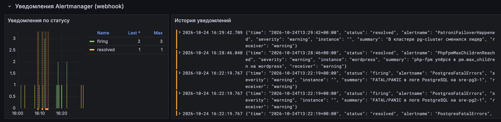<br>**16.** Уведомления Alertmanager через webhook в Loki | |

---

## Эксплуатация и диагностика

```bash
ssh alexander@<IP-ВМ>
cd /opt/sre-stack
alias dc='sudo docker compose'

dc ps                                              # состояние
dc logs <сервис> --tail 50                         # логи сервиса
dc exec pg1 patronictl -c /etc/patroni.yml list    # кластер
dc restart <сервис>                                # перезапуск
dc down -v && dc up -d                             # полный сброс (удаляет данные!)
```

Изменения в конфигах вносятся в репозитории, затем на Маке запускается `ansible-playbook deploy.yml`. Grafana подхватывает дашборды сама в течение 30 секунд; Prometheus перечитывает конфиг по `curl -X POST localhost:9090/-/reload`; Loki и Alertmanager — по `dc restart loki` / `dc restart alertmanager`.

| Симптом | Где смотреть | Частая причина |
|---|---|---|
| Ansible: `Permission denied` | `ssh-add -l` | ключ не загружен в агент или не скопирован на Proxmox |
| «Дождаться SSH» — таймаут | консоль ВМ в Proxmox | неверные IP, маска или шлюз в inventory |
| `docker pull` не идёт | `dc pull` | Docker Hub недоступен → `docker_registry_mirror` в inventory |
| Consul: `No cluster leader` | `dc logs consul1` | разные gossip-ключи → `dc down -v` |
| Нет лидера Patroni | `dc logs pg1` | Consul без кворума или сменились пароли после initdb |
| pgbouncer перезапускается | `dc logs pgbouncer` | в Consul нет сервиса с тегом primary |
| WordPress: «Error establishing a database connection» | `dc logs pgbouncer wordpress` | пароль или недоступный лидер |
| Нет логов в Loki | `dc logs alloy`, UI :12345 | нет доступа к docker.sock |
| Панель Loki: `maximum of series (500)` | запрос панели | `\| json` без списка полей — указать нужные поля |

---

## Ограничения и развитие

**Сознательные компромиссы стенда:**

- **Всё на одной ВМ** — это модель отказоустойчивости: узлы делят ядро, диск и память, и ВМ остаётся единой точкой отказа. В проде узлы БД и Consul стоят на разных хостах или в разных зонах.
- **Асинхронная репликация:** RPO до 1 МБ WAL. Если потеря данных недопустима — `synchronous_mode: true`.
- **pgbouncer в режиме session:** PG4WP получает id новой строки отдельным запросом `LASTVAL()`, в transaction-режиме он мог бы уйти в чужое соединение.
- **WordPress на PostgreSQL** — требование задания. PG4WP фиксирует версию WordPress (6.5) и ограничивает выбор плагинов.

**Что дальше, до настоящего прода:**

1. Резервное копирование и PITR: pgBackRest с архивом WAL, регулярная проверка восстановления.
2. TLS везде: HTTPS, Consul RPC/HTTP, pgbouncer → PostgreSQL.
3. ACL в Consul и файрвол на хостах.
4. Watchdog (softdog) для Patroni.
5. Несколько узлов приложения за балансировщиком, общее хранилище для `uploads`.
6. Отказоустойчивый мониторинг: второй Prometheus, кластер Alertmanager, внешний dead man's switch для `Watchdog`.

---

## Структура репозитория

```
.
├── README.md
├── docker-compose.yml              # весь стенд: 25 сервисов
├── ansible/
│   ├── site.yml                    # provision-pve + deploy одной командой
│   ├── provision-pve.yml           # ВМ Ubuntu 22.04 на Proxmox (qm + cloud-init)
│   ├── deploy.yml                  # Docker и стек на ВМ
│   ├── inventory.yml               # Proxmox, ВМ, параметры
│   ├── group_vars/docker_hosts/    # каналы уведомлений; vault.yml с секретами — не в git
│   ├── templates/                  # alertmanager.yml.j2
│   └── credentials/                # пароли (создаются автоматически, не в git)
├── images/
│   ├── patroni/                    # Ubuntu 22.04 + PostgreSQL 15 + Patroni
│   ├── pgbouncer/                  # pgbouncer + consul-template
│   └── wordpress/                  # WordPress 6.5 + pgsql + PG4WP
├── config/
│   ├── prometheus/                 # prometheus.yml, rules/ (алерты, SLO)
│   ├── alertmanager/               # шаблоны сообщений (конфиг собирает Ansible)
│   ├── webhook-logger/             # приёмник webhook-уведомлений
│   ├── loki/                       # loki.yml, rules/ (алерты по логам)
│   ├── alloy/                      # сбор логов
│   ├── blackbox/                   # модуль проверки сайта
│   ├── nginx/                      # JSON-лог, stub_status, wp-login rate limit
│   └── grafana/                    # provisioning + 6 дашбордов
├── tools/
│   ├── build_dashboard.py          # генератор Platform Overview
│   └── build_detail_dashboards.py  # генератор детальных дашбордов
└── docs/
    └── screenshots/                # скриншоты для отчёта
```

Дашборды не правятся руками в Grafana — они генерируются скриптами из `tools/`. Изменение = правка скрипта → `python3 tools/<скрипт>.py` → `ansible-playbook deploy.yml`.
